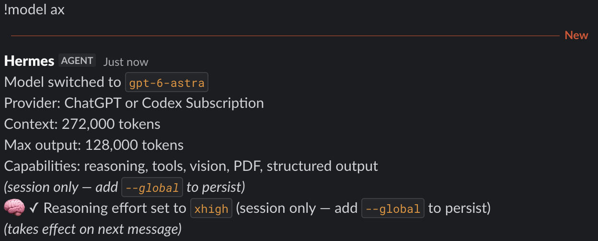

# Hermes Model Presets

Named model, provider and reasoning presets for Hermes messaging.

```text
/model deep
→ /model gpt-5 --provider openai-api --reasoning high --session
```

<p align="center">
  
  <br>
  <em><code>ax</code> switches both the model to <code>gpt-6-astra</code> and the reasoning effort to <code>xhigh</code>.</em>
</p>

## Setup

```sh
hermes plugins install will-lynas/hermes-model-presets --enable
hermes plugins doctor model-presets --ci
```

Add presets to your profile's `config.yaml`, then restart the gateway:

```yaml
plugins:
  entries:
    model-presets:
      settings:
        aliases:
          deep:
            model: gpt-5
            provider: openai-api
            reasoning_effort: high
```

## Usage

```text
/model deep                   # this session only
/model deep --reasoning low   # override the preset's effort
/model deep --global          # save as the default
/model another-model          # unconfigured names pass through
```

Names match exactly, including case. `reasoning_effort` is optional.

Session presets need reapplying after a gateway restart. `--once` isn't expanded.

## Requirements

- Hermes 0.22.5+
- Python 3.11+
- A Hermes messaging gateway; local CLI/TUI, Desktop and API turns aren't supported.

## How it works

The `pre_gateway_dispatch` hook rewrites matching `/model` aliases into full
commands. Hermes then handles the model switch normally. Other commands pass
through unchanged.

[Development](DEVELOPMENT.md) · [MIT](LICENSE)
